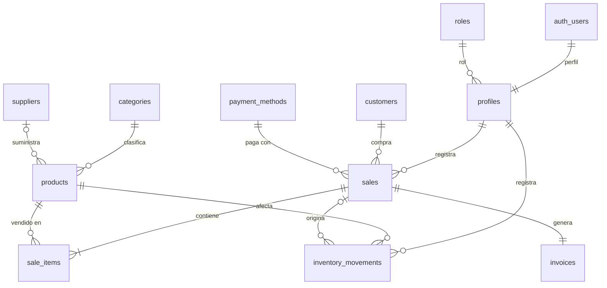

# MASA MOTOS — Sistema de ventas, inventario y facturación

Sistema web para **MASA MOTOS**, empresa dedicada a la comercialización de repuestos y accesorios para motocicletas. Incluye punto de venta, inventario con historial de movimientos, facturación (impresión y PDF), clientes, proveedores, reportes, usuarios con roles y una interfaz completamente bilingüe (**español / inglés**).

**Backend y base de datos: [Supabase](https://supabase.com)** (PostgreSQL + Auth + Storage). No requiere Docker ni contenedores: se ejecuta directamente con Node.js desde Visual Studio Code o la terminal.

> Construido sobre la plantilla TailAdmin (Next.js + Tailwind CSS), que conserva su licencia MIT en `LICENSE`.

## Tecnologías

| Capa | Tecnología |
| --- | --- |
| Framework | Next.js 16 (App Router, Server Components, Server Actions) · React 19 · TypeScript estricto |
| Estilos | Tailwind CSS v4 (tema en `src/app/globals.css`) |
| Base de datos | Supabase PostgreSQL · `@supabase/supabase-js` · `@supabase/ssr` |
| Autenticación | Supabase Auth (correo y contraseña, sesión en cookies httpOnly) |
| Seguridad | Row Level Security (RLS) en todas las tablas · funciones SQL transaccionales |
| Imágenes | Supabase Storage (bucket privado `product-images`) |
| Validación | `zod` (mismos esquemas en cliente y servidor) |
| Idiomas | `next-intl` (diccionarios `src/messages/es.json` y `en.json`) |
| Gráficos / PDF | ApexCharts · jsPDF + jspdf-autotable |

## Módulos

- **Panel principal**: productos registrados / disponibles / con stock bajo / agotados, ventas del día y del mes, ingresos totales, facturas, gráfico diario y mensual, más vendidos, últimos movimientos y alertas.
- **Productos e inventario**: alta, edición, activación/desactivación y eliminación (solo sin historial); búsqueda, filtros, ordenamiento y paginación; imagen del producto; entradas, salidas y ajustes con historial. Las existencias **solo** cambian mediante movimientos registrados y nunca pueden ser negativas (lo garantiza la base de datos).
- **Ventas (POS)**: búsqueda rápida, carrito, descuento (% o valor), IVA configurable, cliente, método de pago, efectivo recibido y cambio. La confirmación se ejecuta en **una sola transacción** en la función SQL `create_sale`: bloquea los productos, valida existencias, calcula los totales con los precios de la base, crea venta y detalle, descuenta inventario, registra movimientos y asigna el consecutivo de factura.
- **Facturación**: factura con identidad de MASA MOTOS, impresión, PDF, historial, búsqueda y anulación (restituye inventario).
  > Las facturas son documentos internos. **No** constituyen facturación electrónica DIAN.
- **Clientes**, **Proveedores**, **Categorías**, **Reportes** (con exportación CSV), **Usuarios** y **Configuración**.

### Permisos

| Acción | Administrador | Vendedor |
| --- | :---: | :---: |
| Panel, consultar productos, ventas, facturas | ✔ | ✔ |
| Registrar ventas y clientes | ✔ | ✔ |
| Crear/editar productos, inventario, categorías, proveedores | ✔ | — |
| Anular ventas, reportes, usuarios, configuración | ✔ | — |

Los permisos se aplican en tres niveles: páginas (servidor), server actions y **políticas RLS** en Supabase.

---

## Puesta en marcha paso a paso

Requisitos: **Node.js ≥ 20.9** y **npm**, una cuenta gratuita en [supabase.com](https://supabase.com) y **Visual Studio Code** (o cualquier terminal).

### 1. Crear el proyecto en Supabase
1. Ingrese a <https://supabase.com/dashboard> → **New project**.
2. Escriba el nombre (`masa-motos`), defina una **contraseña de base de datos** (guárdela) y elija la región más cercana (p. ej. *East US* o *South America (São Paulo)*).
3. Espere a que el proyecto termine de crearse (1–2 minutos).

### 2. Desactivar el registro público
**Authentication → Sign In / Providers** → desactive **Allow new users to sign up**. Así solo el administrador crea las cuentas.

### 3. Copiar las credenciales
1. En VS Code abra la carpeta del proyecto y copie `.env.example` como **`.env.local`**.
2. Complete las variables:

| Variable | Dónde obtenerla en Supabase |
| --- | --- |
| `NEXT_PUBLIC_SUPABASE_URL` | Project Settings → Data API → *Project URL* |
| `NEXT_PUBLIC_SUPABASE_ANON_KEY` | Project Settings → API Keys → *anon public* (o la *publishable key*) |
| `SUPABASE_SERVICE_ROLE_KEY` | Project Settings → API Keys → *service_role* (o la *secret key*). **Secreta: solo servidor** |
| `SUPABASE_DB_URL` | Botón **Connect** (arriba) → *Session pooler* → URI; reemplace `[YOUR-PASSWORD]` |

`.env.local` está en `.gitignore`: nunca se sube al repositorio.

### 4. Instalar dependencias
Terminal de VS Code (`Ctrl + ñ` / `` Ctrl + ` ``):
```bash
npm install
```

### 5. Crear tablas, seguridad y datos de prueba
**Opción A — automática (recomendada):**
```bash
npm run db:setup
```
Aplica los scripts SQL, crea los usuarios de prueba en Supabase Auth, siembra datos y muestra cada tabla con su estado RLS.

**Opción B — manual en el SQL Editor de Supabase:**
1. **SQL Editor → New query**: pegue y ejecute, en orden, `supabase/migrations/001_schema.sql`, `002_security.sql`, `003_functions.sql` y `004_grants.sql`.
2. **Authentication → Users → Add user → Create new user** (marque *Auto Confirm User*). Cree las cuentas indicadas en QA_ADMIN_EMAIL y QA_SELLER_EMAIL con contraseñas únicas, guardadas en QA_ADMIN_PASSWORD y QA_SELLER_PASSWORD en su entorno privado.
3. Ejecute `supabase/seed.sql` en el SQL Editor (activa a los dos usuarios, asigna los roles y carga los datos de prueba).

### 6. Ejecutar la aplicación
```bash
npm run dev           # desarrollo → http://localhost:3000
# o producción:
npm run build
npm start
```
En VS Code también puede usar el panel **NPM Scripts** del explorador y pulsar ▶ en `dev`.

### Otros comandos
| Comando | Descripción |
| --- | --- |
| `npm run db:check` | Verifica la conexión con Supabase, las tablas y RLS |
| `npm run db:reset` | Borra los datos de negocio y vuelve a sembrar la base de prueba |
| `npm run lint` | ESLint |
| `npm run test:e2e` | Prueba de extremo a extremo (con la app en ejecución; usa Edge o Chrome instalados) |
| `npm run evidence` | Regenera las capturas de `docs/evidencias/` |

Para usar otra URL en las pruebas: `BASE_URL=http://localhost:3000 npm run test:e2e`.

## Credenciales de prueba

Los scripts de navegador, las suites de QA y la preparación de cuentas usan QA_ADMIN_EMAIL, QA_ADMIN_PASSWORD, QA_SELLER_EMAIL y QA_SELLER_PASSWORD. Complete estas variables en el entorno privado con las cuentas académicas autorizadas. La plantilla .env.example incluye los cuatro campos vacíos. La ausencia de una credencial detiene el script que la necesita.

La preparación automática requiere ambas cuentas antes de conectarse. El modo npm run db:check solo requiere las variables de conexión. La semilla manual reconoce los correos de demostración definidos en supabase/seed.sql, que deben coincidir con las cuentas creadas para ese procedimiento.

Las contraseñas de demostración se retiraron del código y de esta guía. Las cuentas académicas de administrador y vendedor deben rotarse si conservan esos valores, porque permanecen en el historial de Git. El responsable realizará esa rotación desde la administración de usuarios y actualizará su entorno privado.

## Base de datos (Supabase)

Scripts en `supabase/`:

| Archivo | Contenido |
| --- | --- |
| `migrations/001_schema.sql` | Tablas, relaciones (claves foráneas), índices y restricciones `CHECK` |
| `migrations/002_security.sql` | Perfiles vinculados a Supabase Auth, funciones de rol, **políticas RLS** y bucket de Storage |
| `migrations/003_functions.sql` | Funciones transaccionales (`create_sale`, `void_sale`, `register_movement`, `delete_product`), vistas y funciones de reportes |
| `migrations/004_grants.sql` | Privilegios mínimos de la Data API (los proyectos nuevos de Supabase no los conceden automáticamente) |
| `seed.sql` | Datos de prueba (29 repuestos, 9 categorías, 4 proveedores, 8 clientes, ~75 ventas históricas) |

Todos los scripts se pueden ejecutar más de una vez sin duplicar estructuras.



### Seguridad
- **RLS activo en las 12 tablas.** Un visitante sin sesión no puede leer nada; los usuarios inactivos tampoco.
- **Vendedor:** lee el catálogo, registra clientes y ventas. No puede escribir en productos, inventario ni ventas directamente: las ventas pasan por `create_sale`, que valida rol y existencias.
- **Administrador:** gestiona todo. Anular ventas y mover inventario solo es posible mediante funciones que verifican el rol.
- La clave `service_role` solo se usa en el servidor (`src/lib/supabase/admin.ts`, marcado `server-only`) para crear/editar cuentas de Auth. Nunca llega al navegador.
- Si alguien se registra por su cuenta, su perfil queda **inactivo** y sin acceso hasta que un administrador lo active.

## Bilingüismo (Microcredencial)
- Selector de idioma en el encabezado de todas las páginas (también en el inicio de sesión).
- 575 claves de traducción con paridad exacta entre `es.json` y `en.json`; los errores del servidor y de la base de datos también se traducen.
- El idioma se guarda en la cookie `NEXT_LOCALE` (1 año). Español por defecto.
- Evidencias: `docs/Evidencias_Bilinguismo_MASA_MOTOS.docx` y capturas en `docs/evidencias/`.

## Estructura
```
supabase/               scripts SQL (esquema, RLS, funciones) y datos de prueba
scripts/                configuración de Supabase, pruebas E2E y captura de evidencias
src/app/[locale]/(admin)/   páginas de cada módulo
src/app/api/            imagen de producto (Storage) y exportación CSV
src/components/<módulo>/    componentes por módulo
src/lib/supabase/       clientes de Supabase (servidor y administrador)
src/lib/actions/        server actions (mutaciones validadas y autorizadas)
src/lib/data/           consultas de lectura
src/lib/auth/dal.ts     usuario actual y verificación de permisos
src/proxy.ts            idioma + renovación de sesión de Supabase + protección de rutas
src/messages/           diccionarios es / en
src/config/brand.ts     logo e identidad
```

## Logo e identidad visual
- Logo oficial en `public/images/logo/`, generado a partir del archivo vectorial *logo masa motos.pdf* sin redibujarlo ni alterar sus colores:
  - `masa-motos-logo.png`: logo completo (barra lateral, inicio de sesión, factura y PDF).
  - `masa-motos-mark.png`: escudo y moto (barra lateral contraída, encabezado móvil y favicon).
- El logo conserva su fondo negro original; por eso la barra lateral y el panel de acceso son negros, y en fondos claros se muestra dentro de un recuadro negro.
- Paleta tomada del logo (`src/app/globals.css`): rojo `#FF0000` (escala `brand-*`), azul `#0000FF` → azul oscuro del escudo `#000080` (escala `navy-*`), blanco y negro.
- Configuración centralizada en `src/config/brand.ts`.
